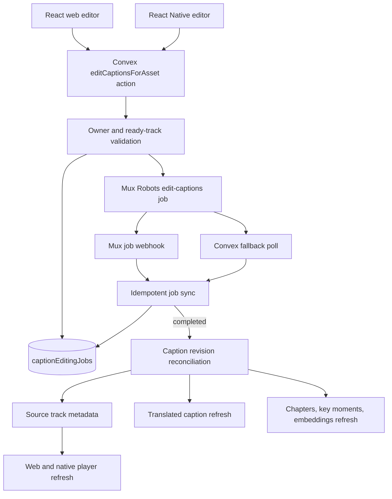

# Robotube Cross-Platform Caption Editing Workflow PRD

> **Status and checkbox rule.** This document defines the product and
> implementation plan. A checked box means the work is already evidenced in the
> current repository or was completed during the PRD investigation. Unchecked
> boxes are implementation, verification, or rollout work still to be done.

- **Status:** Implemented and deployed to development; live Mux and device verification pending
- **Last updated:** 2026-09-10
- **Platforms:** React web, React Native iOS, React Native Android
- **Mux workflow:** `edit-captions` (experimental)
- **Primary Mux reference:**
  [Edit a video's captions](https://www.mux.com/docs/guides/robots-edit-captions)

## 1. Summary

Add an uploader-only **Caption cleanup** workflow to Robotube. A creator can
apply global find-and-replace rules and optional AI profanity censoring to a
ready Mux text track from the web app or React Native app.

The feature uses one shared Convex backend. Clients collect the editing rules,
submit them to an authenticated Convex action, and observe persisted job state.
Convex calls the Mux Robots `edit-captions` endpoint, follows the asynchronous
job through webhooks and fallback polling, records the uploaded edited track,
and refreshes caption-dependent Robotube data.

The preferred entry point is the private upload review flow before publishing.
Creators can also clean up captions on videos they already uploaded from their
profile or creator controls.

Guiding statement:

> Caption edits are a creator-controlled revision of the source caption track,
> backed by one durable job state and one implementation shared by every client.

## 2. Problem Statement

Robotube generates a source caption track and can translate it, but creators
cannot correct recurring transcription mistakes or apply a consistent profanity
policy. A misspelled product name can remain visible in playback and can flow
into translated captions, chapters, key moments, and transcript-backed chat.

The repository already contains much of the required infrastructure:

- `convex/captions.ts` discovers or generates a ready source caption track and
  stores `aiCaptionsTrackId` and source-language metadata.
- `convex/captionTranslations.ts` and
  `convex/captionTranslationsNode.ts` persist and run translated-caption jobs.
- `convex/muxWebhook.ts` verifies and records Mux webhook events and dispatches
  supported Robots workflows.
- `convex/captionEditingNode.ts` implements the authenticated workflow through a
  direct Robots REST adapter because the installed `@mux/ai` package does not
  export this workflow.
- The web and native upload flows keep new videos private until the creator
  explicitly publishes.
- The native video detail screen already discovers and selects Mux caption
  tracks during player source loading.

The implementation now includes the direct Robots API adapter, durable edit-job
state, webhook and polling synchronization, downstream revision handling,
owner-only queries, and editing interfaces for web and React Native. The
remaining work is live Mux, browser, simulator, physical-device, and rollout
verification recorded in the unchecked checklist items below.

## 3. Product Decisions

These are v1 decisions:

1. The user-facing name is **Caption cleanup**. This accurately describes the
   available global replacements and profanity controls without implying a
   cue-by-cue transcript editor.
2. Caption cleanup is available only to the uploader who owns the Mux asset.
3. The feature operates only on an existing Mux text track whose status is
   `ready`.
4. The creator must provide at least one non-empty replacement rule or enable
   automatic profanity censoring.
5. Each submission creates a one-off `edit-captions` Robots job. Interactive,
   creator-specific rules are not stored in a Mux Directive because Directive
   configurations are immutable and intended for repeatable automatic flows.
6. The backend calls the Robots REST endpoint directly. The mobile and web
   clients never receive Mux API credentials.
7. Successful jobs use `upload_to_mux: true`,
   `delete_original_track: true`, and `track_name_suffix: "reviewed"`.
   Mux uploads the edited track before deleting the original.
8. Starting an edit during private upload review disables Publish until the edit
   reaches a terminal state. A creator who does not start an edit can publish
   through the existing flow.
9. Editing an already-published video remains available. Playback continues
   while the asynchronous job runs, then clients adopt the replacement track.
10. Robotube stores job status, IDs, result counts, and errors. It does not store
    the temporary VTT URL, which expires after seven days, as durable product
    state.
11. V1 does not provide undo or caption revision history after the original
    track is deleted. The confirmation UI states this before submission.
12. One active edit job is allowed per asset. A second submission is rejected
    until the first reaches `completed`, `errored`, or `cancelled`.
13. Caption editing remains a Convex-owned interactive job even when Laravel
    owns the automatic ingest pipeline. Fallback polling is therefore required
    in every deployment mode.
14. Editing captions does not alter the source audio or regenerate translated
    audio. Audio censorship and dubbing revisions are separate features.
15. Generated summaries, chapters, key moments, and transcript embeddings
    refresh automatically from the reviewed caption revision. Existing
    creator-authored title, description, and tags remain authoritative.

## 4. Goals

- Let a creator correct repeated words or phrases across a caption track.
- Let a creator censor profanity using `blank`, `remove`, or `mask` mode.
- Support the same job from web, iOS, and Android.
- Preserve private draft behavior during upload review.
- Keep edit progress durable if the app closes, backgrounds, or changes routes.
- Replace the source caption track only after Mux uploads the edited track.
- Ensure playback selects the edited track after completion.
- Refresh translated captions and Robotube data derived from the source captions.
- Prevent unauthorized users from discovering track IDs or starting jobs.
- Avoid duplicate paid Robots jobs from repeated taps, retries, or webhook replay.
- Provide enough status and error information for creators and operators to
  understand failures.

## 5. Non-Goals

- A cue-by-cue transcript editor with timestamp adjustment.
- Editing caption timing, cue boundaries, speaker labels, or VTT styling.
- Generating the initial source caption track; the existing caption pipeline
  continues to own generation.
- Editing third-party videos or videos owned by another Robotube account.
- Editing translated caption tracks independently in v1.
- Caption version history or one-click undo after replacement.
- Audio muting, bleeping, or profanity removal from the source audio.
- Automatically regenerating AI-dubbed audio after caption changes.
- Creating a unique Mux Directive for each creator or edit request.
- Persisting temporary pre-signed VTT URLs as long-lived application data.
- Replacing the current Mux players on web or React Native.

## 6. User Stories

- As an uploader, I can replace a commonly mistranscribed name everywhere in my
  source captions before publishing.
- As an uploader, I can choose whether replacements match case exactly.
- As an uploader, I can automatically censor profanity and choose how censored
  words are displayed.
- As an uploader, I can specify words that should always or never be censored.
- As an uploader, I can see when source captions are still being generated and
  understand why editing is unavailable.
- As an uploader, I can leave the editor while a job runs and see the current
  status when I return.
- As an uploader, I cannot accidentally submit the same edit several times.
- As an uploader, I can clean up captions on an existing published upload.
- As a viewer, the edited caption track becomes the selected track after the job
  completes.
- As an operator, I can trace an edit from a Robotube job row to the Mux job ID
  without logging caption text or credentials.

## 7. User Experience Requirements

### 7.1 Shared editor contract

Web and React Native present the same fields and validation:

- Source caption language and track name, displayed read-only.
- A list of replacement rows:
  - **Find**: required and non-empty for every retained row.
  - **Replace with**: may be empty to delete the matched text.
  - **Case sensitive**: off by default.
- **Auto-censor profanity** switch.
- Censor mode selector: **Blank**, **Remove**, or **Mask**.
- Optional **Always censor** terms.
- Optional **Never censor** terms.
- A primary **Apply caption edits** action.
- A destructive-impact confirmation explaining that the original source caption
  track will be replaced after the edited track uploads successfully.

The clients trim surrounding whitespace from list entries, remove empty optional
terms, and send snake-case conversion only through the backend adapter. Server
validation remains authoritative.

### 7.2 Upload review

The private upload review surface displays one caption card:

- `Preparing captions`: source text track is not ready.
- `Ready to review`: a ready source text track is available.
- `Applying edits`: an edit job is pending or processing.
- `Reviewed`: the most recent edit completed.
- `Could not apply edits`: the most recent edit errored or was cancelled.
- `Unavailable`: the asset has no eligible ready text track.

The card opens the editor. Publish remains enabled when the creator has not
started an edit. Publish is disabled while an edit is active. A completed edit
does not require another acknowledgement before publishing.

### 7.3 Existing upload management

The creator's upload-management surface adds **Edit captions** beside existing
video-management actions. It opens the same editor state used during upload.

Public viewers never see editing controls. The client may hide the entry point
using an owner-state query, but the backend must independently enforce ownership.

### 7.4 Web presentation

- Add an owner-only **Captions** or **Caption cleanup** tab/panel to the watch or
  creator-management surface.
- Use stacked replacement rows that remain usable from tablet width through wide
  desktop layouts.
- Keep job status visible without requiring a page refresh.
- Remount or refresh the web player after the replacement track becomes ready.

### 7.5 React Native presentation

- Add a **Review captions** card to the generated private-draft screen.
- Add **Edit captions** to the management controls for `Your uploads`.
- Open a dedicated full-screen Expo Router screen rather than placing the form
  in a draggable sheet. The screen contains several keyboard-driven fields and
  must remain stable with the iOS and Android keyboards open.
- Use `KeyboardAvoidingView`, safe-area insets, scroll-to-focused-input behavior,
  and a persistent submit area.
- Preserve unsent fields during ordinary React rerenders and orientation changes.
  Persisting unsent rules across app termination is outside v1.
- Announce validation, processing, success, and failure states to assistive
  technologies.

Proposed route:

```text
app/video/[muxAssetId]/edit-captions.tsx
```

### 7.6 Empty and error states

The editor must distinguish:

- user signed out;
- asset missing or deleted;
- user is not the owner;
- asset not ready;
- no text track exists;
- text track exists but is still preparing;
- another edit is active;
- Robots credentials or scope are invalid;
- Mux rejects the request;
- job errors or is cancelled;
- edited track upload completes but subsequent Robotube reconciliation fails.

Messages shown to creators are concise and actionable. Raw Mux responses,
credentials, VTT URLs, and stack traces are not shown.

## 8. Mux Robots Contract

The contract below was verified against the Mux guide on 2026-09-10. Robots is
in beta, so implementation must isolate Mux shapes inside the server adapter.

### 8.1 Create request

```http
POST https://api.mux.com/robots/v0/jobs/edit-captions
Authorization: Basic <server-side Mux credentials>
Content-Type: application/json
```

```json
{
  "passthrough": "{\"muxAssetId\":\"...\",\"userId\":\"...\",\"editRequestId\":\"...\"}",
  "parameters": {
    "asset_id": "MUX_ASSET_ID",
    "track_id": "READY_TEXT_TRACK_ID",
    "replacements": [
      {
        "find": "Mucks",
        "replace": "Mux",
        "case_sensitive": true
      }
    ],
    "auto_censor_profanity": {
      "mode": "blank",
      "always_censor": [],
      "never_censor": []
    },
    "upload_to_mux": true,
    "delete_original_track": true,
    "track_name_suffix": "reviewed"
  }
}
```

At least one of `replacements` or `auto_censor_profanity` is required. Empty
optional objects and arrays are omitted from the final request.

### 8.2 Job lifecycle

Robotube recognizes:

```text
requested -> pending -> processing -> completed
                                  \-> errored
                                  \-> cancelled
```

`requested` is local-only state created before the network request. All other
states mirror Mux Robots.

### 8.3 Completion output

Robotube consumes:

- `total_replacement_count`;
- `uploaded_track_id`;
- `temporary_vtt_url` only for short-lived diagnostics when explicitly needed.

Mux emits `robots.job.edit_captions.<status>` events. Multi-word workflow names
use underscores in webhook event types and hyphens in API endpoint paths.

### 8.4 Directives decision

V1 does not create or attach a Directive for interactive caption edits:

- replacement rules differ for each request;
- the creator submits after inspecting a specific caption track;
- saved Directive configuration is immutable;
- automatic attachment would run before the creator supplies input.

A future organization-wide fixed terminology or profanity policy may use a
versioned Directive after its product behavior and cost are intentionally
approved.

## 9. Target Architecture



The action schedules fallback polling immediately for every active Mux job.
When Convex receives Robots webhooks, webhook synchronization usually wins and
polling becomes a no-op. Caption-editing webhooks remain Convex-owned even when
`USE_LARAVEL_ORCHESTRATION` is enabled, and polling remains an independent
completion path in every mode. Caption-dependent regeneration can explicitly
run through the Convex workers in that mode; a revision marker prevents an
older Laravel run from restoring stale results.

## 10. Data Model

Add `captionEditingJobs` to `convex/schema.ts`:

| Field | Type | Purpose |
|---|---|---|
| `muxAssetId` | string | Target Mux asset |
| `userId` | string | Authenticated uploader who submitted the edit |
| `sourceTrackId` | string | Ready source text track sent to Mux |
| `sourceLanguageCode` | optional string | Source language shown in status UI |
| `status` | status union | Local and Mux lifecycle state |
| `jobId` | optional string | Mux Robots job ID |
| `passthrough` | optional string | Correlation context returned by Mux |
| `uploadedTrackId` | optional string | Replacement track created by Mux |
| `totalReplacementCount` | optional number | Completed replacement count |
| `errorMessage` | optional string | Sanitized creator/operator diagnostic |
| `reconciliationStatus` | optional union | `waiting`, `processing`, `completed`, or `errored` |
| `reconciliationError` | optional string | Sanitized downstream-refresh error |
| `createdAtMs` | number | Local request creation time |
| `updatedAtMs` | number | Last state update time |
| `completedAtMs` | optional number | Terminal completion time |

Indexes:

- `by_asset` on `muxAssetId`;
- `by_asset_created` on `muxAssetId`, `createdAtMs`;
- `by_job` on `jobId` if optional-index behavior is validated for this schema;
- `by_user_created` on `userId`, `createdAtMs` only if a creator-wide job history
  is added during implementation.

Do not persist replacement text, always/never-censor terms, or temporary VTT
URLs in this table. Mux may return request parameters in job webhooks, so access
to stored raw webhook events remains server/operator-only.

## 11. Convex API Design

### 11.1 Public query: editor state

Proposed function:

```ts
captionEditing.getOwnCaptionEditorState({ muxAssetId })
```

Returns only for the authenticated owner:

```ts
type CaptionEditorState = {
  canEdit: boolean;
  unavailableReason?: string;
  sourceTrack?: {
    id: string;
    languageCode?: string;
    name?: string;
    status: string;
  };
  latestJob?: {
    status: CaptionEditingJobStatus;
    jobId?: string;
    uploadedTrackId?: string;
    totalReplacementCount?: number;
    errorMessage?: string;
    reconciliationStatus?: string;
  };
  captionRevision: number;
};
```

The query must not expose arbitrary asset tracks to non-owners.

### 11.2 Public action: submit edit

Extend the existing function:

```ts
captionEditingNode.editCaptionsForAsset({
  muxAssetId,
  trackId,
  replacements,
  autoCensorProfanity,
  deleteOriginalTrack,
})
```

Required changes:

- add `caseSensitive` to each replacement validator;
- normalize and validate all strings server-side;
- require at least one effective operation;
- resolve and verify the uploader from metadata or asset passthrough;
- retrieve the current Mux asset server-side;
- verify `trackId` belongs to that asset and is a ready text track;
- reject a stale track ID if it no longer matches the current source revision;
- reject when another edit is active;
- create a local `requested` row before calling Mux;
- send the direct REST request with server-held credentials;
- patch the row with Mux job ID and initial status;
- schedule fallback polling for active status;
- apply an immediately terminal response through the same sync path;
- return the local row ID, Mux job ID, and status.

### 11.3 Internal mutations and actions

Proposed functions:

- `captionEditing.createRequestedEditInternal`
- `captionEditing.attachMuxJobInternal`
- `captionEditing.syncEditJobInternal`
- `captionEditing.getEditJobInternal`
- `captionEditing.claimReconciliationInternal`
- `captionEditing.finishReconciliationInternal`
- `captionEditingNode.pollCaptionEditJobStatusInternal`
- `captionEditingNode.reconcileCompletedCaptionEditInternal`

All webhook and polling updates flow through the same idempotent sync mutation.
Terminal-state replay must not schedule reconciliation twice.

## 12. Authentication and Validation

The existing caption-editing stub checks that a component video exists, which is
not a sufficient ownership check. `getVideoByMuxAssetId` can return an asset with
no metadata row for the supplied user.

The final action must:

1. Require `getAuthUserId(ctx)`.
2. Retrieve the component video for the authenticated user.
3. Resolve owner from `metadata.userId`, falling back to the parsed asset
   passthrough owner as existing metadata mutations do.
4. Require the resolved owner to equal the authenticated user.
5. Retrieve the current asset from Mux using server credentials.
6. Require asset status `ready`.
7. Find the submitted track ID in `asset.tracks`.
8. Require track type `text` and status `ready`.
9. Require the submitted track to match Robotube's current source-caption track
   or an explicitly selected owner-editable source track.
10. Reject empty operations and invalid censor modes.

Client-side hiding, disabled buttons, and route guards are usability features;
they do not replace these server checks.

## 13. Webhook and Polling Behavior

Extend `convex/muxWebhook.ts` to recognize workflow `edit-captions` when Convex
owns Robots webhook handling.

For every `robots.job.edit_captions.*` event:

- resolve the Mux asset ID from parameters or passthrough;
- resolve the local edit request by `editRequestId` or Mux job ID;
- pass the complete job to the shared sync function;
- return a stable handled reason;
- treat unknown or stale jobs as recorded but unsupported for product sync;
- keep duplicate event delivery idempotent.

Fallback polling calls:

```http
GET /robots/v0/jobs/edit-captions/{JOB_ID}
```

Polling uses bounded attempts and the same retryable status/error rules used by
other Robots adapters. Polling stops when the local row is terminal or a newer
job supersedes it. A missed webhook must not leave the mobile or web client
permanently processing.

## 14. Caption Revision Reconciliation

### 14.1 Source-track metadata

On a completed job with `uploaded_track_id`:

- set `aiCaptionsTrackId` to the uploaded track ID;
- preserve `aiSourceLanguageCode` and its display label;
- set `aiCaptionsEditedAtMs`;
- increment an integer `aiCaptionsRevision`;
- set `aiCaptionsEditJobId` and `aiCaptionsReplacementCount`;
- clear stale caption-edit errors;
- sync the feed read model without overwriting creator-authored metadata.

If Mux reports completion without an uploaded track ID, mark reconciliation
errored and do not advance the revision.

### 14.2 Translated captions

Translated captions derived from the old source are stale after any source edit.
Reconciliation must:

- identify requested translation language codes from video metadata;
- mark existing `captionTranslationJobs` rows stale or requested for the new
  source revision;
- replace the old generated translated text tracks through a bounded,
  idempotent server flow;
- recreate translations from the reviewed source track;
- expose per-language refresh progress to upload status when the video is still
  private;
- never create two ready generated text tracks for the same target language as a
  steady state.

### 14.3 Chapters, key moments, and embeddings

Reconciliation invalidates and regenerates:

- generated chapters;
- generated key moments;
- stored transcript embeddings used by video chat.

The refresh keeps existing viewer-facing results until replacements complete,
then swaps metadata atomically where possible. A partial refresh is visible to
operators and does not roll back the successfully edited Mux caption track.

### 14.4 Summary and creator metadata

Caption changes may improve generated metadata, so v1 automatically refreshes
generated summaries after a reviewed revision. Creator-authored title,
description, and tags remain authoritative. Regeneration obeys the existing
`aiUseGeneratedTitle`, `aiUseGeneratedDescription`, and `aiUseGeneratedTags`
guards and does not overwrite fields the creator edited.

### 14.5 Audio translations

V1 does not regenerate dubbed audio. The current audio-translation request is
based on the asset audio and language configuration, and caption cleanup does
not modify the source audio. The UI does not imply that censoring captions also
censors spoken audio.

## 15. Player Refresh Requirements

### 15.1 React Native

The native detail player currently selects the first caption track after source
load. After an edit completes:

- include `captionRevision` or `uploadedTrackId` in the player source key;
- reset the one-time initial caption-selection guard;
- replace or reload the player source;
- call `player.setCaptionTrack(uploadedTrackId)` when that track is reported;
- preserve current playback time when practical;
- avoid creating a second concurrent player.

### 15.2 Web

After completion:

- reload the media source or remount the player using `captionRevision`;
- select the uploaded track when the player API exposes it;
- preserve playback time when practical;
- avoid a full document refresh.

Viewer clients that did not initiate the edit may adopt the new manifest on the
next playback session. Live cross-session track switching is outside v1.

## 16. Reliability, Idempotency, and Concurrency

- Exactly one active edit is allowed per asset.
- Repeated submit taps return or surface the active job rather than creating a
  second paid Mux job.
- Local request creation and remote job attachment are separate idempotent steps.
- Passthrough includes a stable local `editRequestId` for webhook correlation.
- Poll and webhook races converge through one sync mutation.
- Terminal job updates are monotonic and cannot move back to active status.
- Reconciliation has its own claim/lease so it runs once and is repairable.
- A job completion is successful only when an uploaded replacement track ID is
  present and the track becomes ready on the asset.
- If the uploaded track is still preparing, reconciliation waits for
  `video.asset.track.ready` or performs a bounded asset-status poll.
- Retrying reconciliation never creates another caption-editing Robots job.
- Deleting a video prevents later job or track webhooks from restoring it to the
  feed.

## 17. Privacy, Security, Cost, and Observability

- Mux token ID and secret remain in server deployment variables.
- The active token must include the `robots:*` scope and the environment must
  have accepted the Robots terms.
- Logs and telemetry exclude replacement text, censor lists, raw captions,
  transcripts, VTT URLs, authorization headers, and raw Mux error bodies.
- Product telemetry uses IDs, status enums, counts, durations, and platform.
- Raw verified webhook storage remains operator-only and follows the existing
  retention policy.
- Every user submission may consume Mux AI units. The confirmation UI makes the
  job action clear and submit idempotency prevents accidental duplicate cost.
- Suggested events:
  - `caption_editor_opened`
  - `caption_edit_submitted`
  - `caption_edit_completed`
  - `caption_edit_failed`
  - `caption_edit_reconciliation_completed`
  - `caption_edit_reconciliation_failed`
- Suggested timings:
  - submit-to-Mux-job-created;
  - Mux job created-to-terminal;
  - completion-to-track-ready;
  - reconciliation duration;
  - player refresh-to-edited-caption selection.

## 18. Success Metrics and Acceptance Criteria

- An authenticated owner can submit a valid edit on web, iOS, and Android.
- A non-owner cannot retrieve editable track details or create an edit job.
- Every accepted submission produces at most one Mux job.
- The UI resumes correct status after route changes, app backgrounding, and app
  relaunch.
- At least 99% of completed Mux jobs reach a terminal local state without manual
  repair during staged rollout.
- A completed edit updates the selected source-caption track on the next player
  refresh.
- Private-draft Publish is disabled only while an initiated edit is active.
- Translated caption tracks no longer contain a term replaced in the source after
  reconciliation completes.
- Transcript-backed chat uses embeddings generated from the new caption revision.
- Creator-authored title, description, and tags survive reconciliation.
- Caption editing creates no duplicate ready source or translated tracks in the
  steady state.
- Existing playback, upload, moderation, translation, and deletion flows retain
  their current behavior when the feature flag is off.

## 19. Phased Implementation Checklist

### Phase 0: Product and Architecture Baseline

Goal: lock the v1 contract and document the current integration boundaries.

- [x] Verify the current Mux `edit-captions` parameters, output fields, default
  track replacement behavior, and asynchronous lifecycle.
- [x] Verify that Directives are immutable and choose a one-off job for
  creator-specific editing rules.
- [x] Audit Robotube source-caption generation and `aiCaptionsTrackId` storage.
- [x] Audit caption and audio translation job state.
- [x] Audit Convex Robots webhook routing and the Laravel feature-flag boundary.
- [x] Audit web and React Native private upload review and Publish behavior.
- [x] Audit native caption-track selection and player source replacement.
- [x] Identify the existing disabled caption-editing action stub.
- [x] Define one shared backend with platform-specific clients.
- [x] Create this PRD with checkbox and evidence conventions.
- [x] Confirm the user-facing name **Caption cleanup**.
- [x] Confirm that v1 permanently replaces the source track after successful
  upload and does not provide undo.
- [x] Confirm that post-publish editing is enabled in the first release.

Phase 0 exit gate:

- [x] Product decisions are accepted by the project owner through the request to
  implement this PRD.
- [x] Current code and Mux contract are documented.
- [x] Implementation phases have explicit exit gates.

### Phase 1: Shared Job Data and Owner-State Query

Goal: establish durable, owner-only state before creating remote jobs.

- [x] Add `captionEditingJobs` and required indexes to `convex/schema.ts`.
- [x] Define the shared status validator and TypeScript types.
- [x] Add internal create, attach, retrieve, list, and sync functions.
- [x] Add an idempotent active-job lookup by asset.
- [x] Add `getOwnCaptionEditorState` with authenticated ownership checks.
- [ ] Resolve the current source caption track from fresh Mux asset data.
- [x] Return source language, name, readiness, latest job, and caption revision.
- [x] Ensure non-owners receive no editable track IDs.
- [ ] Add query tests for owner, non-owner, signed-out, missing asset, no track,
  preparing track, ready track, and active job.
- [ ] Add schema and state-transition tests.

The owner-state query reads the webhook/action-synchronized Mux component
record because Convex queries cannot make external network requests. Every edit
action retrieves the current asset directly from Mux before it accepts a source
track or creates a paid job. The fresh-query checkbox remains open until the
read path has an equivalent server refresh mechanism.

Phase 1 exit gate:

- [x] Owner state is durable and queryable without creating a Mux job.
- [x] Unauthorized callers cannot observe or mutate caption-editing state.
- [x] Active-job detection is deterministic through one Convex transaction.

### Phase 2: Mux Job Adapter, Polling, and Webhooks

Goal: complete one real caption edit through the shared backend.

- [x] Replace the disabled `@mux/ai` error in `captionEditingNode.ts` with a
  direct Robots REST adapter.
- [x] Add `caseSensitive` to replacement validation and API mapping.
- [x] Map profanity mode and always/never-censor terms.
- [x] Omit empty optional operations from the Mux body.
- [x] Enforce at least one effective editing operation.
- [x] Copy the complete metadata/passthrough owner verification used by existing
  owner mutations.
- [x] Retrieve the asset and verify the submitted ready text track server-side.
- [x] Create a local request ID before the remote call and include it in
  passthrough.
- [x] Use `upload_to_mux: true`, `delete_original_track: true`, and the reviewed
  track suffix.
- [x] Store the Mux job ID and initial status.
- [x] Add bounded fallback polling for all active jobs.
- [x] Route `edit-captions` Robots events through `muxWebhook.ts` when Convex owns
  Robots webhook processing.
- [x] Normalize polling and webhook payloads through one idempotent sync path.
- [x] Sanitize creator-visible and logged errors.
- [x] Handle immediately terminal create responses.
- [x] Add fake Mux adapter coverage for pending, processing, completed, errored,
  cancelled, malformed, unauthorized, rate-limited, and transient failures.
- [ ] Run one live development edit against a disposable private Mux asset.

Phase 2 exit gate:

- [ ] One request produces one Mux job and one local job history entry.
- [ ] Webhook completion updates local state when Laravel orchestration is off.
- [ ] Polling completion updates local state when Robots webhooks are skipped.
- [ ] The completed row includes uploaded track ID and replacement count.

### Phase 3: Caption Revision Reconciliation

Goal: make every caption consumer adopt the reviewed source revision.

- [x] Add source-caption revision metadata fields.
- [x] Wait for the uploaded edited track to become ready before switching.
- [x] Update `aiCaptionsTrackId` to the uploaded replacement track.
- [x] Increment `aiCaptionsRevision` exactly once per completed edit.
- [x] Add reconciliation claim/lease and terminal state.
- [x] Identify translated-caption rows and tracks derived from the prior revision.
- [x] Reset and regenerate requested translated captions from the reviewed source.
- [x] Prevent duplicate target-language text tracks in steady state.
- [x] Invalidate and regenerate chapters.
- [x] Invalidate and regenerate key moments.
- [x] Replace transcript embeddings from the edited revision.
- [x] Preserve creator-authored title, description, and tags.
- [x] Decide that generated-only summaries refresh automatically.
- [ ] Add reconciliation tests for generated-only summary refresh while
  preserving creator-authored metadata.
- [x] Keep translated audio unchanged and communicate that scope in UI copy.
- [x] Surface reconciliation progress in upload status.
- [x] Add a repair action for completed edits with incomplete reconciliation.
- [ ] Add tests for webhook replay, poll/webhook races, partial downstream
  failures, stale track IDs, and video deletion during reconciliation.

Phase 3 exit gate:

- [x] Source metadata and player state reference the edited track.
- [ ] All requested translated captions reflect the new revision.
- [ ] Chapters, key moments, and embeddings no longer reference stale captions.
- [x] Reconciliation can be safely retried without another paid edit job.

### Phase 4: React Web Caption Cleanup UI

Goal: allow creators to edit and monitor captions from the browser.

- [x] Add an owner-state query to the web watch or creator-management screen.
- [x] Add an owner-only Caption cleanup entry point.
- [x] Build replacement-row add, edit, case-sensitivity, and remove controls.
- [x] Build profanity switch, mode selector, and always/never lists.
- [x] Add shared client validation and server-error mapping.
- [x] Add the original-track replacement confirmation.
- [x] Submit through the shared Convex action.
- [x] Render preparing, ready, pending, processing, completed, errored, and
  unavailable states.
- [x] Keep state current through the Convex query without manual refresh.
- [x] Disable Publish while an upload-review edit is active.
- [x] Refresh the web player and select the reviewed source-language track after
  completion.
- [ ] Add keyboard, focus-order, label, and screen-reader verification.
- [ ] Verify tablet and wide desktop layouts.

Phase 4 exit gate:

- [ ] A creator completes the flow on web without opening the Mux Dashboard.
- [ ] Non-owners and signed-out viewers never see usable editing controls.
- [ ] The web player presents the edited track after completion.

### Phase 5: React Native Upload and Editor UI

Goal: add the same capability to iOS and Android using native interaction
patterns.

- [x] Add `app/video/[muxAssetId]/edit-captions.tsx`.
- [x] Add a Review captions card to the private generated-draft screen.
- [x] Add the editor-state query and shared action hook.
- [x] Build keyboard-safe replacement rows with case-sensitive switches.
- [x] Build profanity controls with accessible native inputs.
- [x] Add term-list editing for always/never censor.
- [x] Add a persistent submit area that respects safe areas and the keyboard.
- [x] Add the original-track replacement confirmation alert.
- [x] Render durable job state after navigation, backgrounding, and relaunch.
- [x] Disable Publish while an initiated edit is active.
- [x] Announce processing, success, failure, and validation errors accessibly.
- [ ] Verify unsent state survives rerenders and orientation changes.
- [ ] Verify long replacement lists remain scrollable on small phones.

Phase 5 exit gate:

- [ ] The same private upload can be edited and published from iOS and Android.
- [ ] Backgrounding or killing the app does not lose submitted-job state.
- [ ] Keyboard and safe-area behavior is correct on both platforms.

### Phase 6: Existing-Upload Management and Player Refresh

Goal: support post-upload edits and immediate creator verification.

- [x] Replace the native upload-card delete overlay with or augment it using a
  creator management menu containing Edit captions and Delete.
- [x] Add the equivalent entry point for the web profile/upload list.
- [ ] Hide entry points for assets without a ready source caption track while
  preserving an explanatory unavailable state.
- [x] Pass caption revision or uploaded track ID into the native player source
  identity.
- [x] Reset the native initial-caption selection guard after revision changes.
- [x] Explicitly select `uploadedTrackId` after source load.
- [x] Refresh the web player without a document reload.
- [x] Preserve playback position during an initiating-client refresh when
  practical.
- [ ] Verify viewers starting a new playback session receive the replacement
  caption manifest.
- [ ] Verify editing a public asset does not interrupt video playback.

Phase 6 exit gate:

- [x] Creators can edit captions on existing uploads from both clients.
- [x] Native and web players select the replacement track.
- [x] No second player instance or duplicate audio appears during refresh.

### Phase 7: Observability, Resilience, and End-to-End Verification

Goal: prove authorization, correctness, durability, and downstream consistency.

- [x] Add privacy-safe lifecycle and reconciliation telemetry.
- [x] Add operator queries for active, failed, stale, and repairable edit jobs.
- [x] Verify logs never contain caption rules, censor lists, VTT URLs, or
  credentials.
- [ ] Test duplicate taps and concurrent web/native submissions.
- [ ] Test missed webhooks with polling recovery.
- [ ] Test duplicate and out-of-order webhooks.
- [ ] Test app background, termination, relaunch, offline, and reconnect.
- [ ] Test edit completion while the player is open.
- [ ] Test edit completion after the source asset is deleted.
- [ ] Test no-audio, no-caption, preparing-caption, and errored-caption assets.
- [ ] Test correction propagation into every requested translated language.
- [ ] Test chapters, key moments, and video-chat retrieval after revision.
- [ ] Test that creator-authored metadata is never overwritten.
- [x] Run web typecheck/build and repository tests.
- [ ] Run iOS Simulator functional verification.
- [ ] Run Android emulator functional verification.
- [ ] Run one physical iOS device test.
- [ ] Run one physical Android device test or record the rollout blocker.

Phase 7 exit gate:

- [ ] Authorization and idempotency tests pass.
- [ ] Web, iOS, and Android end-to-end flows pass.
- [ ] Missed events recover automatically.
- [ ] Derived caption consumers are demonstrably current.
- [ ] No sensitive caption content appears in telemetry or ordinary logs.

### Phase 8: Staged Rollout

Goal: ship with a fast disable path and measurable quality gates.

- [x] Add a backend `captionEditingEnabled` kill switch.
- [x] Deploy the shared schema, query, actions, webhook handling, and polling to
  the development Convex deployment.
- [ ] Add optional platform gates for web, iOS, and Android.
- [ ] Keep all entry points hidden when disabled while retaining job history.
- [ ] Enable for local development and one disposable private asset.
- [ ] Enable for internal accounts in the development deployment.
- [ ] Review job success rate, completion latency, reconciliation failures, and
  duplicate-job count.
- [ ] Enable for a small group of creator accounts.
- [ ] Verify Mux Robots usage and cost against expected submissions.
- [ ] Enable web generally.
- [ ] Enable iOS generally after physical-device validation.
- [ ] Enable Android generally after physical-device validation.
- [ ] Document rollback and repair procedures.

Phase 8 exit gate:

- [x] The feature can be disabled without changing existing caption playback.
- [ ] Rollout metrics meet Section 18 targets.
- [ ] Support and repair steps are documented and exercised.

### Implementation evidence and remaining verification

Checked implementation items are supported by the repository diff and static
validation. The implementation has passed Convex code generation and typecheck,
the root TypeScript check, ESLint, the web production build, all repository
Node tests, and `git diff --check`.

The development Convex function specification exposes the public owner query,
edit action, status retry action, reconciliation repair action, and existing
owner video-deletion action.

Unchecked items intentionally track evidence that static validation cannot
provide: a disposable live Mux edit, webhook/poll race and reconciliation fault
tests, browser layout and assistive-technology checks, iOS and Android simulator
and physical-device runs, and staged rollout metrics. No live caption-editing
job was submitted while implementing this PRD.

## 20. Definition of Done

- [x] Every Phase 0 product decision is accepted.
- [x] Shared backend, data model, Mux adapter, polling, and webhook sync are live
  in the development deployment.
- [x] Caption revision reconciliation is idempotent and repairable.
- [x] Web, iOS, and Android expose the owner-only workflow.
- [x] Private upload review and existing-upload management both work.
- [x] Players select the edited track after completion.
- [ ] Caption translations and transcript-derived Robotube features are current.
- [ ] Authorization, privacy, accessibility, and concurrency checks pass.
- [ ] Physical-device verification is recorded for iOS and Android.
- [ ] Rollout gates and rollback instructions are complete.

## 21. References

- [Mux: Edit a video's captions](https://www.mux.com/docs/guides/robots-edit-captions)
- [Mux: Use the Mux Robots API](https://www.mux.com/docs/guides/robots)
- [Mux: Run Robots workflows automatically with Directives](https://www.mux.com/docs/guides/robots-directives)
- `convex/captionEditingNode.ts`
- `convex/captions.ts`
- `convex/captionTranslations.ts`
- `convex/captionTranslationsNode.ts`
- `convex/muxWebhook.ts`
- `convex/videoMetadata.ts`
- `convex/videoEmbeddingsNode.ts`
- `convex/laravelFlag.ts`
- `web/src/App.tsx`
- `app/(tabs)/upload.tsx`
- `app/(tabs)/profile.tsx`
- `app/video/[muxAssetId].tsx`
